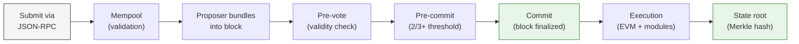

> ## Documentation Index
> Fetch the complete documentation index at: https://docs.arc.io/llms.txt
> Use this file to discover all available pages before exploring further.

# System overview

> Arc separates consensus from execution across two layers: Malachite orders and finalizes blocks, Reth processes transactions and maintains state.

Arc is a two-layer blockchain. The **consensus layer** (Malachite) orders
transactions and finalizes blocks. The **execution layer** (Reth) processes
those transactions, applies state changes, and produces a new state root. This
separation lets each layer optimize independently while delivering sub-second
deterministic finality and full EVM compatibility.

## Two-layer architecture

### Consensus layer (Malachite)

The consensus layer runs [Malachite](/arc/concepts/consensus-layer), a
high-performance implementation of the Tendermint BFT protocol. Its job is to
agree on transaction order and finalize blocks across a permissioned validator
set. Malachite uses a two-phase voting process (pre-vote and pre-commit) that
requires more than two-thirds of validators to agree before a block is
committed. Once committed, the block is final and irreversible.

Key properties:

* **Deterministic finality** in under one second, with no reorganization risk
* **High throughput** of 3,000+ TPS with 20 validators (benchmarked at \<350 ms
  finality)
* **Proof-of-Authority** validator set composed of regulated institutions

### Execution layer (Reth)

The execution layer runs [Reth](/arc/concepts/execution-layer), a Rust
implementation of the Ethereum execution client. It maintains the full
blockchain state (accounts, balances, contracts, storage), executes EVM
transactions, and extends the standard execution pipeline with Arc-specific
modules.

Core responsibilities:

* **Maintain the ledger** -- track accounts, balances, smart contracts, and
  transaction history
* **Execute transactions** -- apply EVM logic, deduct gas fees, and route
  through Arc modules
* **Produce the state root** -- compute a Merkle root of the updated state for
  consensus to finalize

## Transaction lifecycle

A transaction moves through both layers in sequence. The consensus layer orders
and finalizes, then the execution layer processes and applies state changes.

1. **Submit.** A user or application sends a signed transaction to an Arc node
   via JSON-RPC.
2. **Mempool.** The node validates the transaction for correctness (valid
   signature, sufficient balance, proper nonce) and holds it in the transaction
   pool.
3. **Propose.** A rotating validator is selected as proposer for the current
   round. It bundles pending transactions from the mempool into a candidate
   block and broadcasts it to the validator set.
4. **Pre-vote.** Each validator evaluates the proposed block and broadcasts a
   vote indicating whether the block is valid.
5. **Pre-commit.** Validators broadcast a second round of votes. If more than
   two-thirds of validators pre-commit to the same block, the block proceeds to
   commit.
6. **Commit.** The block is finalized and appended to the chain. Every
   transaction in the block is now irreversible.
7. **Execution.** Reth applies each transaction to the current state. The EVM
   processes smart contract logic and transfers, while Arc modules (Fee Manager,
   and in the future, Arc Privacy Sector (APS) and Stablecoin Services) handle
   their respective functions.
8. **State root.** Reth computes a Merkle root of the updated state. This root
   serves as a cryptographic commitment to the entire post-block state.

The entire lifecycle completes in under one second. For a deep dive into the
consensus protocol, see [consensus layer](/arc/concepts/consensus-layer). For
details on how Reth processes transactions, see
[execution layer](/arc/concepts/execution-layer).

## Arc-specific modules

Arc extends the standard EVM execution pipeline with modules that provide
stablecoin-native capabilities. These modules run inside the execution layer and
process transactions alongside standard EVM logic.

| Module                                                           | Status  | Function                                                                                                     |
| :--------------------------------------------------------------- | :------ | :----------------------------------------------------------------------------------------------------------- |
| **[Fee Manager](/arc/concepts/stable-fee-design)**               | Live    | Stabilizes gas fees using USDC as the unit of account. Uses EWMA smoothing to prevent short-term fee spikes. |
| **[Arc Privacy Sector (APS)](/arc/concepts/opt-in-privacy)**     | Planned | Confidential execution environment for Solidity contracts, composing synchronously with the public EVM.      |
| **[Stablecoin Services](/arc/concepts/stablecoin-native-model)** | Planned | Powers crosscurrency settlement, paymaster-sponsored transactions, and multi-stablecoin gas payments.        |

<Info>
  Arc Privacy Sector (APS) and Stablecoin Services are on the roadmap and not
  yet available on Arc.
</Info>

Arc also includes the **CallFrom precompile**, which preserves `msg.sender`
across delegated calls. This precompile is used by the Memo contract and
Multicall3From to enable batched and annotated transactions. For details on how
these differ from standard Ethereum behavior, see
[EVM compatibility](/arc/references/evm-differences).

## Developer benefits

* **Instant settlement.** Deterministic finality means you can trigger
  downstream actions (webhooks, database writes, notifications) as soon as a
  block commits, with no confirmation polling or reorg handling.
* **Familiar stack, native extensions.** Deploy Solidity contracts with standard
  Ethereum tooling. Fee stabilization, privacy, and stablecoin primitives are
  built into the execution layer, not bolt-on services.
